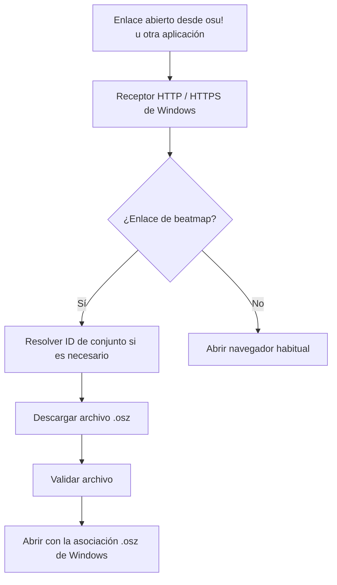

# osu! Auto Direct

  

**Descarga e importa beatmaps de osu! sin abrir el navegador.**

[English documentation](README.en.md)

## Acerca del proyecto

osu! Auto Direct es una pequeña utilidad nativa para Windows que busca simplificar la descarga de beatmaps de osu!, especialmente cuando falta una canción en una partida multijugador. En lugar de abrir la página del mapa, la aplicación recibe el enlace, descarga el archivo `.osz` a través de un servidor externo y solicita a Windows abrirlo con osu!.

El objetivo es reducir los pasos entre seleccionar una canción y tenerla disponible en el juego. No modifica osu!, no necesita extensiones del navegador y no solicita credenciales.

> **Versión experimental:** el código y el ejecutable se han compilado y las pruebas unitarias se han ejecutado. Todavía no se ha verificado la integración completa en Windows, la disponibilidad real de los mirrors ni la importación desde osu! stable o lazer. El ejecutable no está firmado digitalmente.

## Características

- Ejecutable de Windows x64 escrito en Go, sin dependencias externas de ejecución.
- Reconocimiento de enlaces de beatmapsets y beatmaps de `osu.ppy.sh`, incluidos formatos antiguos.
- Descarga automática en segundo plano y servidor alternativo para la descarga.
- Validación básica de archivos ZIP/.osz, rutas y límites de tamaño antes de abrirlos.
- Reenvío de enlaces normales al navegador seleccionado.
- Registro por usuario, sin permisos de administrador.
- Sin servicio residente: se inicia al recibir un enlace y termina al completar la operación.

## Cómo funciona



## Instalación

1. En la sección **Releases** del repositorio, descarga el ZIP de Windows x64 de la versión disponible.
2. Extrae el ZIP y ejecuta `osu-Auto-Direct.exe`. Confirma o selecciona tu navegador habitual.
3. En Windows, abre **Configuración > Aplicaciones > Aplicaciones predeterminadas**.
4. Busca **osu! Auto Direct** y selecciónalo para los protocolos HTTP y HTTPS. No cambies las asociaciones `.html` o `.htm`.
5. Comprueba que la extensión `.osz` esté asociada con tu cliente de osu!.
6. Abre un beatmap que no tengas instalado desde el juego.

No se modifica automáticamente la elección de aplicaciones predeterminadas de Windows: el usuario debe confirmar este cambio.

### Pruebas manuales sugeridas

- Pulsa `Win + R`, escribe `https://example.com` y comprueba que abre el navegador habitual.
- Pulsa `Win + R` y escribe `https://osu.ppy.sh/beatmapsets/320118`. Comprueba la descarga y la importación en osu!.
- Desde una sala multijugador, intenta descargar un beatmap que no tengas instalado.
- Si no se importa, revisa `%LOCALAPPDATA%\OsuAutoDirect\Downloads` y la asociación `.osz`.

## Limitaciones y privacidad

- La aplicación recibe **todos** los enlaces HTTP/HTTPS que Windows le entregue como receptor predeterminado, no solo los de osu!. No identifica qué proceso originó el enlace; los clics internos de un navegador normalmente no pasan por este receptor.
- Los enlaces normales se pasan directamente al navegador seleccionado. El código no los registra ni los envía a los mirrors.
- Los identificadores de beatmaps y los datos normales de conexión (como la IP) se comunican a los servicios de descarga externos. No se usan credenciales de osu!.
- Los archivos se guardan en `%LOCALAPPDATA%\OsuAutoDirect\Downloads`. El programa no garantiza su eliminación tras importarlos; puedes borrar los sobrantes manualmente.
- Límite de descarga por archivo: 512 MiB. La comprobación de ZIP es estructural y no equivale a un análisis antivirus ni garantiza la seguridad del contenido.
- Si los mirrors cambian sus API, están caídos o no disponen del mapa, la descarga puede fallar. Si falla, se ofrece abrir la página original.
- Usa únicamente beatmaps que estés autorizado a descargar y respeta las condiciones de los servicios externos.

## Servidores de descarga

- [Hinai — documentación de descarga](https://mirror.hinamizawa.ai/docs/beatmap-download) y [consulta de beatmaps](https://mirror.hinamizawa.ai/docs/beatmap-info): proveedor principal y resolución de ID.
- [Catboy](https://catboy.best/): servidor alternativo de descarga de conjuntos cuando falla Hinai. No es un respaldo de la resolución de ID.

Estos servicios son independientes del proyecto y pueden cambiar sin previo aviso.

## Compilar desde el código fuente

Se requiere [Go 1.23 o superior](https://go.dev/dl/). Para distribuir nuevas compilaciones, utiliza una versión de Go con mantenimiento de seguridad.

Desde PowerShell, en la raíz del repositorio:

```powershell
go test ./...
$env:GOOS = "windows"
$env:GOARCH = "amd64"
$env:CGO_ENABLED = "0"
go build -trimpath -ldflags="-H=windowsgui -s -w" -o osu-Auto-Direct.exe .
```

También puedes ejecutar `COMPILAR.bat`. El flujo de GitHub Actions ejecuta pruebas y genera un ejecutable como artefacto cuando se ejecuta correctamente.

## Desinstalación

1. Restaura tu navegador habitual como receptor de HTTP y HTTPS desde Windows.
2. Ejecuta `DESINSTALAR.bat` (o el ejecutable instalado con `--uninstall`).
3. Elimina `%LOCALAPPDATA%\OsuAutoDirect` si ya no necesitas sus archivos. No se eliminan los mapas ya importados en el juego.

## Contribuciones

Las sugerencias, informes de errores y mejoras son bienvenidos. Consulta [CONTRIBUTING.md](CONTRIBUTING.md) y abre un Issue o Pull Request. Antes de compartir información de diagnóstico, elimina datos privados.

## Aviso

Este es un proyecto comunitario independiente. No está afiliado, patrocinado ni respaldado por osu!, ppy Pty Ltd ni los proveedores de mirrors. No proporciona ni sustituye oficialmente el servicio osu!direct. Los nombres y marcas pertenecen a sus respectivos titulares.

La distribución del código no incluye beatmaps ni contenido musical.

## Licencia

La licencia MIT se propone para este repositorio; consulta [LICENSE](LICENSE). Revisa y confirma la titularidad y la licencia antes de publicar el proyecto.

## Demo & Screenshots

### Video Demonstration

A real-world demonstration of osu! Auto Direct running on Windows, showcasing the automatic beatmap download and import process without opening a web browser.


